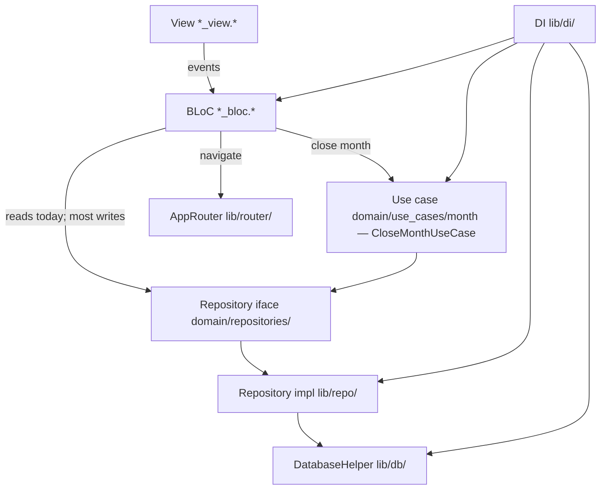

# Architecture — Budget Manager

Budget Manager uses a layered, local-first architecture: the domain stays pure
(no Flutter/UI/DB), repositories implement domain interfaces against SQLite,
and presentation (BLoC + views) depends inward. There is **no remote HTTP API**.

## Layers

Order layers from innermost (most pure, fewest dependencies) to outermost.

| Layer | Directory | Responsibility | May depend on |
|-------|-----------|----------------|---------------|
| Domain | `lib/domain/` | Entities, DB/map models, repository interfaces, and use cases under `use_cases/<group>/` (`CloseMonthUseCase` is the first). Pure Dart — no Flutter. | (nothing internal) |
| Data-access | `lib/repo/` | Repository implementations that fulfil domain interfaces (and `ThemeRepository`). | Domain, DB |
| Persistence | `lib/db/` | `DatabaseHelper` — connection, schema, migrations, and SQL CRUD (current single helper; **target:** split into connection + DAOs). | Domain models, logger |
| Infra / services | `lib/services/` | Reserved; `navigation_service.dart` is empty. No `platform/` folder. | — |
| Presentation | `lib/screens/` | Views + BLoCs. Views render; BLoCs hold logic and navigation. | Domain, router, di, theme |
| Cross-cutting | `lib/router/`, `lib/di/`, `lib/theme/`, `lib/logger/` | Routing (`AppRouter` / go_router), get_it wiring, design tokens / themes, shared logger. | Domain + presentation as needed |

## Core rules

1. **BLoCs** perform reads and writes through **domain repository interfaces**
   today. Prefer **use cases** for non-trivial writes/deletes when introducing
   them; do not call `DatabaseHelper` from BLoCs or views.
2. **All navigation happens in BLoCs** — never route-level navigation in
   views or shared widgets. Every screen must be registered with a route in
   `lib/router/`. Views only dispatch events (e.g. `backTapped`); the BLoC
   navigates by calling `AppRouter` (`go` / `push` / `pop` / `goHome`). Views
   must not import the router or use `context.go` / `context.push`.
   Local overlay dismiss (`Navigator.pop` for dialogs/sheets) is allowed.
3. **No persistence / plugin I/O in BLoCs or views** — reach the DB only
   through repository interfaces implemented in `lib/repo/`.
4. **The domain is pure** — it must not import any outer layer or Flutter.
5. **HTTP / remote API** — N/A. Do not add a shared HTTP client or API
   completion logging unless a remote surface is explicitly introduced.

## Logger setup

Centralize the `logger` package in `lib/logger/logger.dart`. **Current code**
exports an unconfigured `Logger()`. Prefer configuring `PrettyPrinter` with a
short stack trace from the log call site:

```dart
import 'package:logger/logger.dart';

final logger = Logger(
  printer: PrettyPrinter(
    methodCount: 1,
    errorMethodCount: 1,
    lineLength: 120,
  ),
);
```

Temporary diagnostic logs: `logger.d` only — remove before finishing.

## Strict import table

This is the authoritative deny-list. Prose is the **only** enforcement today
(see [enforcement.md](enforcement.md)). When a lint-rules package and
architecture test are added, they must encode exactly this table.

- **`lib/domain/**`** must not import: `package:flutter`, `lib/screens/`,
  `lib/repo/`, `lib/db/`, `lib/services/`, `lib/router/`, `lib/di/`,
  `lib/theme/`, `package:flutter_bloc` / `package:bloc`, `package:go_router`,
  `package:sqflite`.
- **`lib/repo/**`** must not import: `package:flutter` (except if a future
  theme/prefs adapter truly requires it — prefer none), `lib/screens/`,
  `lib/router/`, `lib/di/`, `package:flutter_bloc` / `package:bloc`,
  `package:go_router`.
- **`lib/db/**`** must not import: `package:flutter`, `lib/screens/`,
  `lib/repo/`, `lib/router/`, `lib/di/`, `package:flutter_bloc` / `package:bloc`,
  `package:go_router`.
- **`lib/services/**`** (if used as infra adapters) must not import:
  `lib/screens/`, `lib/repo/`, `lib/db/`, `lib/router/`, `lib/di/`,
  `package:flutter_bloc` / `package:bloc`, `package:go_router`.
- **Views (`*_view.*`)** must not import: `lib/repo/`, `lib/db/`,
  `lib/router/`, `lib/di/`, `package:go_router` (no `context.go` / `context.push`).
- **Controllers (`*_bloc.*` / `*_event.*` / `*_state.*`)** must not import:
  `lib/repo/` (use domain interfaces only), `lib/db/`, `package:sqflite`,
  `package:go_router` (use `AppRouter` from `lib/router/` instead of importing
  go_router APIs directly in BLoCs when possible).
- **Shared components** must not import: `lib/repo/`, `lib/db/`,
  `lib/router/`, `lib/di/`, `package:flutter_bloc` / `package:bloc`,
  `package:go_router`.

## Data flow



Domain interfaces live in `lib/domain/`; `RepoImpl` implements them from
`lib/repo/` and is wired in `lib/di/`. **Current:** repository impls call
`DatabaseHelper` directly (SQL lives in the helper). **Target:** DAO-per-table
under `lib/db/daos/` returning domain types; helper becomes connection +
migrations only.

### Persistence layout (current vs target)

**Current**

```
lib/db/
└── database_helper.dart   # open/version/migrations + all SQL CRUD
```

**Target** (when split)

```
lib/db/
├── app_database.* / database_helper.*   # connection, version, transaction()
├── schema/                              # optional DDL
├── migrations/                          # incremental upgrade steps
└── daos/<entity>_dao.*                  # one DAO per table
```

### Read path (current)

1. BLoC calls `MonthRepository.getMonth(id)` (domain interface).
2. `MonthRepositoryImpl` calls `DatabaseHelper` → maps models → domain `Month`.
3. BLoC receives domain type only.

### Write path (current)

1. BLoC calls repository methods (e.g. `BudgetByMonthRepository` update spend).
2. Impl writes via `DatabaseHelper`.

### Write path — close month

1. `IndexBloc` calls `CloseMonthUseCase.call(monthId)` then navigates.
2. Use case loads the month, persists `RegularPaymentSnapshot` first, then
   **awaits** `MonthRepository.closeMonth`. A retry after a failed close
   reuses the stored snapshot. `IndexBloc` navigates only on
   `CloseMonthResult.completed`.
3. Each impl writes via `DatabaseHelper` (two sequential calls; not one
   transaction). Do **not** add `closeMonthWithSnapshot`.

Other writes stay on repositories until they grow similar orchestration.

### Write path (target, additional use cases)

1. BLoC dispatches to a use case under `domain/use_cases/<group>/`.
2. Use case calls the repository interface.
3. Impl / DAO persists.

### DI (`lib/di/di.dart`)

`setupDependencies()` registers database, router, theme, repositories, use
cases (when present), then screens. Prefer keeping split helpers
(`registerDatabase`, `registerRepositories`, `registerUseCases`,
`registerScreens`, …) with comment-marked sections. This integration adds
`registerUseCases()` for `CloseMonthUseCase` and calls it from the startup
method (after repositories, before screens).

## Remote DTOs

N/A — no HTTP/JSON API. Local maps use domain models
(`fromMap` / `toMap` / `toEntity`). If a remote API is added later, JSON DTOs
belong in the repo path — see `docs/agent-guidelines/03-serialization.md`.

## Changing a boundary

A boundary change should update:

1. The **Strict import table** above.
2. Deny-lists in a future lint-rules package (see [enforcement.md](enforcement.md)).
3. A future architecture import test under `test/architecture/`.

Today only (1) exists. If automated checks are added later and they disagree
with this table, **the table wins** and the other artifacts are bugs.

Feature design specs live under `docs/*-design-spec.md`. Regularity Calendar
(`RegularPayment`, schema v3) is specified in
[`regularity-calendar-design-spec.md`](regularity-calendar-design-spec.md) and
does not change the import table. Budget integration
(`RegularPaymentSnapshot`, schema v4) is in
[`regularity-budget-integration-design-spec.md`](regularity-budget-integration-design-spec.md)
and also does not change the import table.
