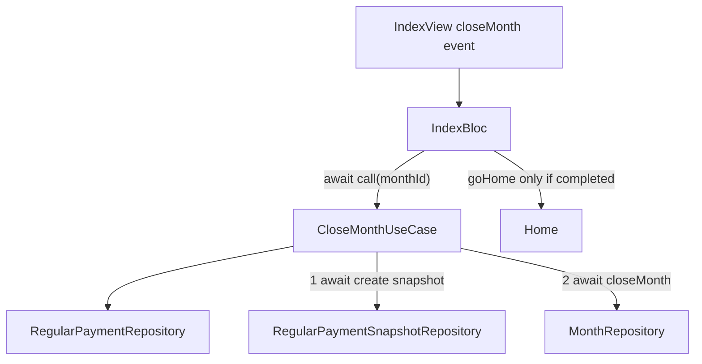

# Regularity × Budgets — Integration Design Spec

<!--
  AGENT METADATA — parse before implementing
  feature_id: regularity-budget-integration
  product_name: Budget Manager
  source: product request (list regulars on live month; freeze snapshot on close)
  target_platform: Flutter (Android-focused mobile)
  status: shipped
-->

> **Purpose:** Plan how Regularity Calendar payments appear on the live month
> and how they are frozen into history when a month closes.
> **Audience:** Coding agents and contributors. Follow `AGENTS.md` and
> `docs/architecture.md` before writing code.
> **Related:** [`regularity-calendar-design-spec.md`](regularity-calendar-design-spec.md),
> [`budgeting-core-design-spec.md`](budgeting-core-design-spec.md),
> [`screens-navigation-design-spec.md`](screens-navigation-design-spec.md).
> **UI tokens:** [`ui-theme-design-spec.md`](ui-theme-design-spec.md),
> [`DESIGN_SYSTEM.md`](DESIGN_SYSTEM.md),
> [`UI_IMPLEMENTATION_GUIDE.md`](UI_IMPLEMENTATION_GUIDE.md).

---

## Document map

| § | Section |
|---|---------|
| 0 | [Repo conventions](#0-repo-conventions) |
| 1 | [Product rules](#1-product-rules) |
| 2 | [Data model](#2-data-model) |
| 3 | [Close month](#3-close-month) |
| 4 | [Totals](#4-totals) |
| 5 | [Live month UI](#5-live-month-ui) |
| 6 | [History UI](#6-history-ui) |
| 7 | [Other surfaces](#7-other-surfaces) |
| 8 | [Out of scope](#8-out-of-scope) |
| A | [Implementation order](#appendix-a-implementation-order) |
| B | [Checklist](#appendix-b-checklist) |

---

## 0. Repo conventions

| Rule | This feature |
|------|--------------|
| BLoC + Freezed | No new screens. Extend `IndexBloc`, `HistoryShowBloc`, `HistoryIndexBloc`, `HomeBloc` state. After Freezed edits run `dart run build_runner build --delete-conflicting-outputs` |
| Routes | **No new routes.** Regulars stay display-only; do not navigate to calendar or edit from live/history lists |
| Navigation in BLoCs | Unchanged. Views still must not `context.push` / `context.go` (live index currently does — do **not** add more view navigation; do not make regulars tappable) |
| Widget classes | Reuse `CustomListTile` (`silent: true`), `SectionLabel`, `CustomListView`. Private divider/list widgets in `index_view.dart` / `history_show_view.dart` if they stay screen-specific. Extract a shared display-only payment row only if both screens use the same widget |
| Infra I/O | `RegularPaymentRepository` + new `RegularPaymentSnapshotRepository`. **No** `DatabaseHelper` in BLoCs/views or use cases |
| Persistence | New table; bump `DatabaseHelper` from **3 → 4** + `_migrations[4]` + `onCreate` |
| Writes | **`CloseMonthUseCase`** owns close + snapshot. `IndexBloc` calls the use case only — not `MonthRepository.closeMonth`. Persist the snapshot **first**, then **await** `closeMonth`. No `closeMonthWithSnapshot`. Retry after a failed close reuses the stored snapshot |
| Errors | Existing `SnackBar` / dialog patterns. `IndexBloc` navigates **only** on `CloseMonthResult.completed`. On failure, reload persisted state and stay on the screen |
| Theme | `context.appColors` + `textTheme`. 1px divider (`colors.border`). No emojis. All 6 themes |

**Replaces:** Regularity Calendar “budget integration is out of scope”.

**Does not replace:** Envelope rules (no transaction ledger, one open month, irreversible close). Regular payments are **not** turned into `Budget` / `BudgetByMonth` rows.

---

## 1. Product rules

Users already define year-agnostic regular payments (rent, insurance, …) on
the Regularity Calendar. Those payments must show up on **budget months** so
income totals are honest, without mixing them into envelope rows.

### 1.1 Live (open) month

- After the **Budgets** list, show a **1px divider** and a **display-only**
  list of regular payments that occur in that month’s **calendar month**
  (`Month.date.month`, 1–12). Match `RegularPayment.occursInMonth` /
  `RegularPaymentRepository.getByMonth`.
- **Not tappable.** No ink splash, no chevron, no route to calendar/edit.
- **Income spent** and **Budgeted income** on this screen include the **sum of
  those live regulars** (see §4).
- Live list is **not frozen**. If the user edits Regularity Calendar and
  returns (or taps refresh), the list and totals update.

### 1.2 Close month (freeze)

Closing a month is still irreversible (`closedOn` set). **`CloseMonthUseCase`**
builds **one** `RegularPaymentSnapshot`, **saves it first**, then awaits
`closeMonth` (see §3). Snapshot fields:

| Field | Value |
|-------|--------|
| `monthId` | The month being closed |
| `items` | Names of every regular payment that occurs in that calendar month, ordered like calendar (`name COLLATE NOCASE ASC`) |
| `amount` | Sum of those payments’ `amount` values (0.0 if none) |

Always insert **one** snapshot, even if there are no matching payments
(`items = []`, `amount = 0`). That keeps history reads simple (row exists
after any close on schema v4+).

Do **not** copy per-payment amounts into the snapshot. Names + one total only.

### 1.3 History (closed months)

History must **not** re-query live `regular_payments`. Templates change; closed
months must keep what was true **at close**.

- Read `RegularPaymentSnapshot` by `monthId`.
- Totals use `snapshot.amount` (0 if no row — months closed before this
  feature).
- UI lists `snapshot.items` (names only) under the same divider pattern.

### 1.4 Open vs closed on Live Index

History **Edit** FAB still pushes `/index/:monthId`. That screen can show a
**closed** month.

| `Month.closedOn` | Regular source | Totals extra |
|------------------|----------------|--------------|
| `null` (open) | Live `RegularPaymentRepository.getByMonth(date.month)` | Sum of live amounts |
| non-null (closed) | `RegularPaymentSnapshotRepository.getByMonthId` | Snapshot `amount` (0 if missing) |

Never mix live template rows into a closed month’s totals.

### 1.5 Matching calendar month, not budget `months.id`

Budget `Month` is a period row. Regularity is a **calendar-month mask**.
Bridge: `month.date.month` ∈ `1...12`. Year is ignored (same as the calendar
feature).

---

## 2. Data model

Independent of `Budget` / `BudgetByMonth`. FK only to `months`.

### Entity (`lib/domain/entities/regular_payment_snapshot.dart`)

```dart
class RegularPaymentSnapshot {
  final int id;
  final int monthId;
  final double amount;
  final List<String> items;

  RegularPaymentSnapshot({
    required this.id,
    required this.monthId,
    required this.amount,
    required this.items,
  });

  factory RegularPaymentSnapshot.empty() => RegularPaymentSnapshot(
        id: 0,
        monthId: 0,
        amount: 0,
        items: const [],
      );
}
```

- `id == 0` means not yet persisted.
- `items` is an ordered list of **names only** (duplicates allowed if two
  payments share a name).

Do **not** hang the snapshot off `Month` as a required field. Keep `Month`
envelope-only (`totalUsed` / `budgetedIncomeAmount` stay budget-row sums).
Presentation adds snapshot/live regulars on top (see §4).

### Model (`lib/domain/models/regular_payment_snapshot_model.dart`)

| Dart | DB column | Notes |
|------|-----------|--------|
| `id` | `id` INTEGER PK | Omit from `toMap()` when `id == 0` (same as other models) |
| `monthId` | `month_id` INTEGER FK→months CASCADE | One snapshot per month |
| `amount` | `amount` REAL | Sum at close |
| `items` | `items_json` TEXT | JSON array of strings, e.g. `["Rent","Netflix"]` |

Helpers (pure Dart, unit-testable):

- `static String encodeItems(List<String> items)` → `jsonEncode`
- `static List<String> decodeItems(String raw)` → `jsonDecode`; invalid/null → `[]`

`fromMap` / `toMap` / `toEntity` / `fromEntity` / `empty` — same shape as
existing models. Use `dart:convert` only in the model (domain stays Flutter-free).

### Schema (`budget_manager.db` version **4**)

Bump `_databaseVersion` from 3 → 4.

**`onCreate`:** also create this table so fresh installs get it.

```sql
CREATE TABLE regular_payment_snapshots (
  id INTEGER PRIMARY KEY AUTOINCREMENT,
  month_id INTEGER NOT NULL UNIQUE,
  amount REAL NOT NULL DEFAULT 0.0,
  items_json TEXT NOT NULL DEFAULT '[]',
  FOREIGN KEY (month_id) REFERENCES months(id) ON DELETE CASCADE
)
```

**`_migrations[4]`:** same `CREATE TABLE` (existing installs).

`UNIQUE (month_id)` enforces one snapshot per month. Closing twice is already
product-forbidden; the unique constraint is a safety net.

No backfill for months already closed on v3. Missing snapshot ⇒ treat as
`amount = 0`, `items = []`, hide the regulars section.

### Repository

`lib/domain/repositories/regular_payment_snapshot_repository.dart`

```dart
abstract interface class RegularPaymentSnapshotRepository {
  Future<RegularPaymentSnapshot?> getByMonthId(int monthId);
  Future<Map<int, RegularPaymentSnapshot>> getByMonthIds(List<int> monthIds);
  Future<int> create(RegularPaymentSnapshot snapshot);
}
```

- `getByMonthIds`: one query for History Index (`WHERE month_id IN (...)`),
  keyed by `monthId`. Empty map entries mean “no snapshot”.
- No update/delete API. Month delete cascades.
- Close path **does** call `create` after `closeMonth` — see §3. Do **not**
  add a combined persist method on `MonthRepository`.

`lib/repo/regular_payment_snapshot_repository_impl.dart` delegates to
`DatabaseHelper` CRUD (same pattern as other repos).

### DI

In `registerRepositories()`:

```dart
getIt.registerLazySingleton<RegularPaymentSnapshotRepository>(
  () => RegularPaymentSnapshotRepositoryImpl(getIt<DatabaseHelper>()),
);
```

Inject snapshot (and live payment) repos into BLoCs that **read** them
(`IndexBloc`, `HistoryShowBloc`, `HistoryIndexBloc`, `HomeBloc` as in §7).
**Do not** inject snapshot-create into `IndexBloc`. Close is only
`CloseMonthUseCase`.

In `registerUseCases()` (new helper, called from `setupDependencies()` after
repos, before screens):

```dart
getIt.registerLazySingleton<CloseMonthUseCase>(
  () => CloseMonthUseCase(
    getIt<MonthRepository>(),
    getIt<RegularPaymentRepository>(),
    getIt<RegularPaymentSnapshotRepository>(),
  ),
);
```

`IndexBloc` factory: pass `CloseMonthUseCase` instead of calling
`MonthRepository.closeMonth`. Keep `MonthRepository` on the BLoC for
`getMonth`.

---

## 3. Close month

This is the first `domain/use_cases/` type in the app. Group by entity:
`lib/domain/use_cases/month/close_month_use_case.dart`. Name:
`CloseMonthUseCase`. Pure Dart — repository **interfaces** only; no Flutter,
`DatabaseHelper`, or BLoC.

### Current code

`IndexBloc` calls `repoMonth.closeMonth(state.month.id)` then `goHome()`.
`MonthRepositoryImpl.closeMonth` only sets `closedOn`.

### Target flow



### `CloseMonthUseCase`

Constructor takes `MonthRepository`, `RegularPaymentRepository`, and
`RegularPaymentSnapshotRepository`. Returns `CloseMonthResult`
(`completed` / `notFound`):

1. `getMonth(monthId)`. If missing, return `notFound`.
2. If `closedOn != null`, return `completed` (idempotent; do **not** insert a
   second snapshot).
3. `getByMonthId`. If a snapshot already exists, skip capture/create.
4. Otherwise `getByMonth(month.date.month)` and `create` the snapshot
   (names + sum, including empty).
5. **`await monthRepository.closeMonth(monthId)`**.
6. Return `completed`.

Do **not** add `closeMonthWithSnapshot`. Snapshot-first is the durable
protocol: if `closeMonth` fails after `create`, a retry closes without
recapturing live payments. If `create` fails, the month stays open and a
retry captures again.

`IndexBloc` navigates home **only** on `completed`. On thrown failures it
reloads persisted state, shows a SnackBar, and stays.

### Tests (`test/domain/use_cases/month/close_month_use_case_test.dart`)

Fake `MonthRepository`, `RegularPaymentRepository`, and
`RegularPaymentSnapshotRepository`:

| Case | Expect |
|------|--------|
| Unknown `monthId` | `notFound`; no writes |
| Already `closedOn` | `completed`; no writes |
| Open month, two payments | `create` then `closeMonth`; items = names; amount = sum |
| Open month, no payments | `create` then `closeMonth`; `items = []`; `amount = 0` |
| `create` throws | No `closeMonth` |
| `closeMonth` throws after `create` | Snapshot kept; exception propagates |
| Retry after failed close | No second `create`; `closeMonth` then `completed` |
| Duplicate close after success | No extra writes |

---

## 4. Totals

Keep `Month.totalUsed` and `Month.budgetedIncomeAmount` as **envelope-only**.
Regulars are an extra addend in presentation/BLoC:

```
regularsTotal     = open ? sum(live.amount) : (snapshot?.amount ?? 0)
incomeSpent       = month.totalUsed + regularsTotal
incomeBudgeted    = month.budgetedIncomeAmount + regularsTotal
spentPct          = income > 0 ? incomeSpent / income * 100 : 0
budgetedPct       = income > 0 ? incomeBudgeted / income * 100 : 0
```

**Why both spent and budgeted?** Regulars are committed outflows (count as
spent) and they consume income that cannot be allocated to envelopes (count
as budgeted). They are not envelope limits and not `currentUsed` on a fake
budget.

Do **not** persist these combined totals on `months`. Derive at read time.

Put `MonthIncomeTotals.fromMonth` on Live, Home, History Index, and History
Show so the addend cannot drift. Unit-test the helper.

---

## 5. Live month UI

Screen: `lib/screens/live/index/` (`IndexView` + `IndexBloc`). **No new
route.**

### State additions (`IndexState`)

- `List<RegularPayment> regularPayments` — live rows when open; **empty**
  when closed (closed UI uses snapshot names).
- `RegularPaymentSnapshot? snapshot` — set when `month.closedOn != null`.
- Derived getters on state are fine: `regularsTotal`, `displayNames` /
  display rows.

Load both sources on `started` / `refresh` according to §1.4.

### Layout (inside the existing `Column`)

Keep header, summary row, stale-month banner, `SectionLabel('Budgets')`.

Replace “budgets-only `Expanded` + `CustomListView`” with **one** scroll
(`Expanded` → `CustomListView` or `SingleChildScrollView`) whose children
are:

1. Existing `BudgetByMonthListTile`s (tappable as today).
2. If there is at least one regular **to show**:
   - A **divider**: 1px `colors.border`, full list width (or slight vertical
     padding 8–12). Not a 3px border. Not a tappable tile.
   - `SectionLabel('Regular payments')` (uppercase via the widget).
   - One **silent** `CustomListTile` per payment:
     - Open month: `title` = name, `trailing` = formatted amount + ` €`
       (same `_fmt` as summary cards).
     - Closed month: `title` = snapshot item name; **no** per-item amount
       (not stored). Optional muted trailing omitted.
     - `silent: true`, `onTap: null`. No chevron.

If there are no regulars (open: empty `getByMonth`; closed: empty `items` or
null snapshot), **omit** divider, label, and list. Do not show an empty-state
sentence on Live.

### Interaction

- Section is **display only**. Do not wrap in `InkWell` / `GestureDetector`.
- Do not open Regularity Calendar or month-details dialog from here.
- Refresh FAB already exists — it must reload regulars/snapshot as well as
  budgets.

### Summary cards

```
Income spent     → `${_fmt(incomeSpent)} of ${_fmt(income)} €`
Budgeted income  → `${_fmt(incomeBudgeted)} €`
```

Percent badges use the combined numerators in §4.

---

## 6. History UI

No new history screen. No new routes.

### 6.1 History Show (`/history/:monthId`)

Mirror Live’s lower section, snapshot-only:

- Summary **Income spent** uses `totalUsed + (snapshot?.amount ?? 0)`.
- After the budget list: divider + `SectionLabel('Regular payments')` +
  silent name tiles from `snapshot.items`.
- Hide the block when `items` is empty / snapshot is null.
- Optional compact total row under the names (`Total` + formatted
  `snapshot.amount`) — recommended so the section has an amount despite
  name-only items. Reuse `SummaryStatCard` or a muted total line; do **not**
  add a second tappable card.
- Tiles remain **not tappable**. Budgets stay `silent: true` as today.
- Edit FAB unchanged (still Live Index for that month). Closed-month Live
  Index uses the snapshot per §1.4.

`HistoryShowState` gains `RegularPaymentSnapshot? snapshot`. BLoC loads it in
`started` via `getByMonthId`.

### 6.2 History Index (`/history`)

`MonthListTile` progress pill is `ProgressPill(month.totalUsed, month.income)`
today. That **undercounts** spend after this feature.

Options (pick **A**):

**A (recommended).** `HistoryIndexBloc` loads `getByMonthIds` and passes
`spentOverride` (or a small view model) into `MonthListTile`:

`spentOverride: MonthIncomeTotals.fromMonth(month, regularPayments: snapshotAmount).spent`.

**B.** Do not change the index pills (only Show). Rejected: index would
disagree with Show/Live.

Do **not** put snapshot amount onto `Month.totalUsed`.

Tiles on the index remain tappable **into History Show** (month rows), not
into regulars.

### 6.3 Visual consistency

Live and History Show should look like the same list language: 16px radius
tiles, 1px `border`, 12px gap (`CustomListView`). Divider is the only new
chrome.

---

## 7. Other surfaces

These consume the same “income spent” idea. Include them in the **same
change** so numbers do not disagree.

| Surface | Change |
|---------|--------|
| Home Current Month hero | Open month: `totalUsed + sum(getByMonth(date.month))` in the spent line and progress percent. Inject `RegularPaymentRepository` into `HomeBloc` |
| AI Insights prompt text | Closed months: add snapshot amount to “Total spent”. Open month in range: add live regulars for that calendar month **or** skip if too heavy — **minimum:** closed months use snapshot so history analysis matches History Show. Document whichever choice in the implementation PR |

Regularity Calendar screens stay unchanged.

---

## 8. Out of scope

- Creating `Budget` / `BudgetByMonth` rows from regular payments
- Per-item amounts on the snapshot (names + one sum only)
- Editing regulars from Live/History
- Notifications / due dates / day-of-month
- Per-year exceptions
- Backfilling snapshots for months closed before v4
- New routes or a dedicated history regulars screen
- Additional use cases beyond `CloseMonthUseCase` (spend adjust, hide budget, etc. stay on repos)
- Changing envelope visibility SQL

---

## Appendix A. Implementation order

Same PR is fine:

1. **Domain + DB + repo + DI** — entity, model (+ JSON helpers), table v4,
   snapshot repo, `CloseMonthUseCase` (snapshot then `closeMonth`),
   `registerUseCases()`. Compile-safe, no UI.
2. **Totals helper** + unit tests (spent/budgeted addend; JSON round-trip;
   use case table in §3).
3. **`IndexBloc` / `IndexView`** — load live vs snapshot; summary cards;
   divider + silent list; `await closeMonthUseCase(...)`.
4. **History Show** — snapshot load; summary; divider + name list + total.
5. **History Index** — pill includes snapshot amount.
6. **Home hero** (and AI if in-scope).
7. Docs: this spec `status → shipped`; schema note in
   `budgeting-core-design-spec.md`; Live/History bullets in
   `screens-navigation-design-spec.md`; entity list in
   `project-structure.md`; architecture persistence blurb.
8. `flutter analyze` (+ `flutter test`).

---

## Appendix B. Checklist

```
[x] RegularPaymentSnapshot entity + model (JSON items) + repo iface + impl
[x] DatabaseHelper v4: onCreate table + _migrations[4]; UNIQUE month_id
[x] CloseMonthUseCase under domain/use_cases/month/; IndexBloc awaits it only
[x] Use case: create snapshot first, then closeMonth; navigate only on completed
[x] DI: snapshot repo, registerUseCases, extra repo args on read BLoCs
[x] Live Index: divider + silent regulars; spent/budgeted include regulars
[x] Closed month on Live Index uses snapshot, not live template
[x] History Show: snapshot names + amount in income spent; not tappable
[x] History Index pills include snapshot amount
[x] Home hero spent includes live regulars for the open month
[x] All four surfaces use MonthIncomeTotals
[x] No new routes; no taps on the regulars section
[x] No RegularPayment writes into budget_by_month
[x] Unit + widget tests: JSON, totals, close use case, Live and History UI
[x] Update this spec status → shipped
[x] flutter analyze (feature clean; 11 pre-existing repository infos remain)
```
