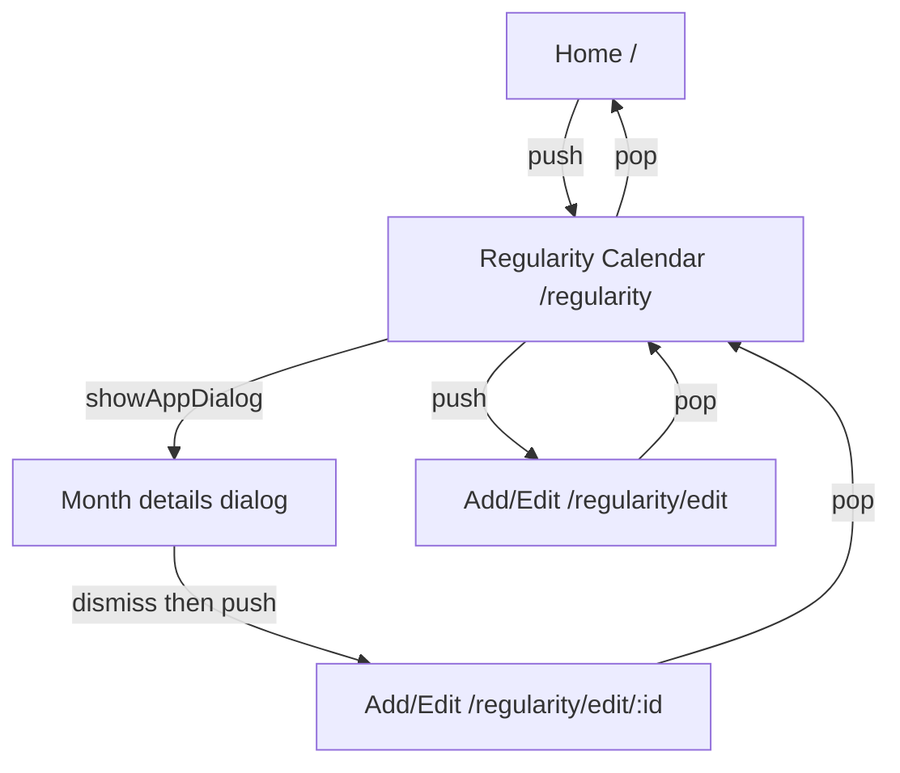

# Regularity Calendar — Design & Layout Specification

<!--
  AGENT METADATA — parse before implementing
  feature_id: regularity-calendar
  product_name: Budget Manager
  source: product request (foreseeable regular payments)
  target_platform: Flutter (Android-focused mobile)
  status: shipped
-->

> **Purpose:** Implement Regularity Calendar as a new hub-and-spoke feature:
> year grid of calendar-month totals, month-details **dialog**, and add/edit
> payments. Persistence is local SQLite; budget-month integration is specified
> separately in [`regularity-budget-integration-design-spec.md`](regularity-budget-integration-design-spec.md).
> **Audience:** Coding agents and contributors. Follow `AGENTS.md` and
> `docs/architecture.md` before writing code.
> **UI tokens / components:** [`ui-theme-design-spec.md`](ui-theme-design-spec.md),
> [`DESIGN_SYSTEM.md`](DESIGN_SYSTEM.md),
> [`UI_IMPLEMENTATION_GUIDE.md`](UI_IMPLEMENTATION_GUIDE.md).
> **Routes / home hub:** [`screens-navigation-design-spec.md`](screens-navigation-design-spec.md).
> **Review fixes:** [`regularity-calendar-review-fix-design-spec.md`](regularity-calendar-review-fix-design-spec.md).

---

## Document map

| § | Section |
|---|---------|
| 0 | [Repo conventions](#0-repo-conventions) |
| 1 | [Feature overview](#1-feature-overview) |
| 2 | [Data model](#2-data-model) |
| 3 | [Component reuse](#3-component-reuse) |
| 4 | [Screens](#4-screens) |
| 5 | [Navigation & state](#5-navigation--state) |
| 6 | [Interaction & tokens](#6-interaction--tokens) |
| 7 | [Out of scope](#7-out-of-scope) |
| A | [Implementation checklist](#appendix-a-implementation-checklist) |
| B | [Confirmed defaults](#appendix-b-confirmed-defaults) |

---

## 0. Repo conventions

| Rule | This feature |
|------|--------------|
| BLoC + Freezed | One folder per screen: `*_bloc`, `*_event`, `*_state`, `*_view` |
| Routes in `lib/router/app_router.dart` | Register calendar and add/edit only |
| Navigation in BLoCs | Views dispatch events — no `context.push` / `context.go` |
| Widget classes | Shared: `screens/components/`; screen-private: in `*_view.*` |
| Infra I/O | `RegularPaymentRepository` via DI into BLoCs; **no** `DatabaseHelper` in BLoCs/views |
| Persistence | New table; bump `DatabaseHelper` version + `_migrations` entry |
| Writes | Repository methods (match current codebase). Do **not** introduce `domain/use_cases/` for this feature unless a follow-up explicitly asks |
| Errors | `SnackBar` for validation and repository failures; `showAppDialog` for month details and delete confirm |
| Theme | `context.appColors` + `Theme.of(context).textTheme` only |

**Replaces:** N/A (new feature). Does not change envelope-budgeting rules.

**Reference implementations:** `home/` (NavCard entry), `history/history_index/`
(list + totals), `settings/update_income/` (numeric field + €),
`settings/manage_budgets/` (FAB / add affordance).

---

## 1. Feature overview

### 1.1 Product rules

Users define **regular payments** (rent, insurance, subscriptions, …) so they
can see **how much is due in each calendar month**.

- **Not a transaction ledger.** Each regular payment is a named amount plus
  which **calendar months of the year** it occurs in (1–12).
- **Year-agnostic recurrence.** Selecting March means every March, every year.
  The grid is a **forecast template**, not tied to `months` / open budget
  periods. Budget integration is separate from this feature.
- **Currency:** Euro (€) only. **Locale:** English only.
- **Local-only:** no auth, cloud, notifications, or import/export.

### 1.2 Navigation pattern

Hub-and-spoke from **Home**. New `NavCard` **pushes** the calendar so the
calendar can **pop** back to Home. Calendar and edit views dispatch
`backTapped`; their BLoCs call `AppRouter.pop()`.

Month details is **not a route**. It is an **alert-style dialog** over the
calendar (`showAppDialog` with rich content), with the calendar **faded**
behind a scrim. It is **not** a modal bottom sheet and **not** a registered
screen.



### 1.3 Screens

| Screen | Route | Folder | Top bar |
|--------|-------|--------|---------|
| Regularity Calendar | `/regularity` | `screens/regularity/calendar/` | Regularity Calendar |
| Add / Edit payment | `/regularity/edit` and `/regularity/edit/:id` | `screens/regularity/edit/` | New payment / Edit payment |

Month details: private widget in `regularity_calendar_view.dart`. **No**
`month_detail` screen folder, **no** `/regularity/month/:month` route, **no**
extra BLoC.

### 1.4 Flows

- **Home → Calendar:** `HomeEvent.openRegularity` → `AppRouter.push('/regularity')`.
- **Calendar loads:** repository `getAll`; BLoC computes 12 month sums.
- **Calendar → Home:** header back / `router.pop()` (Home stays under calendar).
- **Tap month cell:** view opens month-details **dialog** (local overlay). Data
  comes from calendar state (filter `occursInMonth`).
- **Tap + bar:** `openCreate` → `AppRouter.push('/regularity/edit')`. Further
  create/edit events are ignored until that `push` returns.
- **Tap payment tile in the dialog:** dismiss the dialog (`Navigator.pop` on
  the overlay), then `openEdit(id)` → `AppRouter.push('/regularity/edit/:id')`.
  The same in-progress gate applies so create and edit cannot stack.
- **Save / delete:** validate → persist → **`AppRouter.pop()` only**. Do **not**
  `go('/regularity')` (that would replace the stack and block Calendar → Home).
  Overlapping save/delete events while loading or a write is in flight are
  dropped.
- After edit pops, calendar BLoC **reloads** in place (await `push`, then
  `started` / `refresh`).

---

## 2. Data model

Independent of `Budget`, `BudgetByMonth`, and `Month`. Do **not** add FKs to
those tables in this change.

### Entity (`lib/domain/entities/regular_payment.dart`)

```dart
class RegularPayment {
  final int id;
  final String name;
  final double amount;
  /// Calendar months 1–12. Must be unique; empty is invalid at save time.
  final Set<int> months;

  RegularPayment({
    required this.id,
    required this.name,
    required this.amount,
    required this.months,
  });

  bool occursInMonth(int month) => months.contains(month);

  factory RegularPayment.empty() => RegularPayment(
        id: 0,
        name: '',
        amount: 0,
        months: const {},
      );
}
```

- `id == 0` means not yet persisted (create mode).
- `months` values are always in `1...12`.

### Model (`lib/domain/models/regular_payment_model.dart`)

Maps SQLite row ↔ entity.

| Dart | DB column | Notes |
|------|-----------|--------|
| `id` | `id` INTEGER PK | Omit from `toMap()` when `id == 0` (same as `BudgetModel`) |
| `name` | `name` TEXT | |
| `amount` | `amount` REAL | |
| `months` | `months_mask` INTEGER | Bit `n` (0-based) = calendar month `n + 1`. January = bit 0 |

Helpers on the model (pure Dart, unit-testable):

- `static int maskFromMonths(Set<int> months)`
- `static Set<int> monthsFromMask(int mask)`

Example: January + March → bits 0 and 2 → `months_mask = 5`.

`fromMap` / `toMap` / `toEntity` / `fromEntity` / `empty` — same shape as
existing models.

### Schema (`budget_manager.db` version **3**)

Bump `_databaseVersion` from 2 → 3.

**`onCreate`:** also create this table so fresh installs get it.

```sql
CREATE TABLE regular_payments (
  id INTEGER PRIMARY KEY AUTOINCREMENT,
  name TEXT NOT NULL,
  amount REAL NOT NULL DEFAULT 0.0,
  months_mask INTEGER NOT NULL DEFAULT 0
)
```

**`_migrations[3]`:**

```sql
CREATE TABLE regular_payments (
  id INTEGER PRIMARY KEY AUTOINCREMENT,
  name TEXT NOT NULL,
  amount REAL NOT NULL DEFAULT 0.0,
  months_mask INTEGER NOT NULL DEFAULT 0
)
```

No foreign keys. No soft-delete in v1 (hard delete from edit screen).

### Repository

`lib/domain/repositories/regular_payment_repository.dart`

```dart
abstract interface class RegularPaymentRepository {
  Future<List<RegularPayment>> getAll();
  Future<RegularPayment?> getById(int id);
  Future<List<RegularPayment>> getByMonth(int month); // 1–12
  Future<int> create(RegularPayment payment);
  Future<void> update(RegularPayment payment);
  Future<void> delete(int id);
}
```

`lib/repo/regular_payment_repository_impl.dart` delegates to new
`DatabaseHelper` CRUD (same pattern as `BudgetRepositoryImpl`).

SQL for `getByMonth(month)`:

```sql
SELECT * FROM regular_payments
WHERE (months_mask & (1 << (? - 1))) != 0
ORDER BY name COLLATE NOCASE ASC
```

Month cell sum is **derived in the calendar BLoC** (or repository helper):
sum of `amount` for payments where `occursInMonth(m)`. Prefer computing 12
sums from one `getAll()` to avoid 12 queries.

### DI

In `registerRepositories()`:

```dart
getIt.registerLazySingleton<RegularPaymentRepository>(
  () => RegularPaymentRepositoryImpl(getIt<DatabaseHelper>()),
);
```

In `registerScreens()`, factory-register the **two** new BLoCs (comment
`// Regularity Calendar`): calendar + edit.

---

## 3. Component reuse

| Widget | Use when |
|--------|----------|
| `ScreenHeader` | Calendar and add/edit screens |
| `NavCard` | Home entry (not AI variant) |
| `CustomListView` + `CustomListTile` | Payment rows inside the month-details **dialog** |
| `SectionLabel` | “MONTHS” above the month-select grid on add/edit |
| `SummaryStatCard` | Dialog **sum block** (label “Total”, value formatted €) |
| `AppDialog` / `showAppDialog()` | Month-details rich content + delete confirmation |
| New **private** widgets in calendar / edit `*_view.dart` | Calendar 3×4 cell; rectangular + bar; month-select cell; month-details dialog |

Do **not** create shared components unless a widget is used on 2+ screens.
Calendar cell and month-select cell are similar visually; keep them
**screen-private** in v1 (calendar cells show a sum; select cells are
toggleable with no amount). Extract later if they converge.

**Do not** reuse `MonthListTile` / `BudgetByMonthListTile` — those are for
budget periods, not calendar months.

---

## 4. Screens

### Home (change)

Add a `NavCard` **after History, before Settings**:

- Title: `Regularity Calendar`
- Subtitle: `Recurring payments by month`
- Icon: `Icons.calendar_month_outlined`
- Event: `HomeEvent.openRegularity()`

No new home color token. Use default `NavCard` (`surface` + `border`).

### Regularity Calendar

```yaml
route: /regularity
folder: lib/screens/regularity/calendar/
bloc: RegularityCalendarBloc
view: RegularityCalendarView
```

Layout (`SafeArea` + `ScreenHeader` + horizontal inset 20):

1. Optional muted caption under the header: current **calendar year** as
   context only (e.g. `2026`). It does **not** change which months appear or
   which payments are summed.
2. **3×4 grid** of equal cells (3 columns, 4 rows). Order: Jan … Dec,
   left-to-right, top-to-bottom.
3. Each cell:
   - Short English month label (`Jan`, `Feb`, …) via `textTheme.labelMedium`
   - Sum of regular payments for that calendar month, formatted €, via
     `textTheme.titleLarge` (or `labelSmall` / DM Mono if it fits better —
     prefer `titleLarge` for the amount, `€` suffix)
   - `colors.surface`, 16px radius, **1px** `colors.border`
   - Tap → month-details dialog (calendar stays underneath, faded)
   - Empty month still tappable; show `0 €`
4. **12px** gap between cells (match `CustomListView` card gap).
5. Below the grid, **full grid width**, rectangular button:
   - Height comfortable for tap (~52–56px)
   - 12px radius (button, not card)
   - `colors.primaryAction` fill, `colors.primaryActionForeground` icon
   - Child: `Icons.add` only (no extra label)
   - Tap → create screen

Empty state: still show the grid of zeros; the + bar is the add path. No extra
empty illustration.

### Month details (dialog, not a screen)

Local overlay on the calendar. Use `showAppDialog` with `contentWidget` and
`barrierColor`, **not** raw `showDialog`, `showModalBottomSheet`, or `GoRouter`.

```yaml
host: RegularityCalendarView
widget: private _RegularityMonthContent in regularity_calendar_view.dart
```

- **Scrim:** theme-aware fade over the calendar, e.g. `barrierColor:
  colors.onScaffold.withValues(alpha: 0.45–0.55)`. Barrier dismissible.
- **Dialog surface:** default `AlertDialog` theming / `colors.surface`; 16px
  radius already from theme. No `ScreenHeader` (that is for routes).
- **Title:** full English month name (`January` … `December`) via
  `textTheme.headlineMedium`.
- **Body:** constrained max height (~50–60% of screen). Scrollable list of
  tiles (name + amount €). Empty: muted `No regular payments in this month.`
- **Below the list (not scrolled away):** sum block — `SummaryStatCard` or a
  compact total row (`Total` + formatted €).
- **Add +** stays on the calendar, not in the dialog.

Tap tile → `Navigator.pop` the dialog, then calendar BLoC `openEdit(id)`.

Do not register a route or a third BLoC for this popup.

### Add / Edit

```yaml
route: /regularity/edit           # create
route: /regularity/edit/:id       # edit; id must be a positive integer
folder: lib/screens/regularity/edit/
bloc: RegularityEditBloc
view: RegularityEditView
```

**One screen, two modes.** `started({int? id})`: if `id` is null, empty form;
else load `getById`. Invalid ids, missing records, and repository exceptions
pop back to the calendar; they must never fall through to create mode.

Layout:

1. `ScreenHeader`: `New payment` or `Edit payment`.
2. Scrollable form (keyboard insets: `viewInsets.bottom`):
   - Name `TextField` (`labelText: 'Name'`).
   - Amount `TextField`:
     - `keyboardType: TextInputType.numberWithOptions(decimal: true)`
     - `FilteringTextInputFormatter` allowing digits + one decimal separator
     - `suffixText: '€'`
     - Reject non-numeric paste by formatter; BLoC still parses with
       `double.tryParse`
   - `SectionLabel` `MONTHS`
   - **Select grid** 3×4 matching calendar month order. Each cell is a
     toggle for that calendar month (selected = occurs).
     - Unselected: `surface` + `border`
     - Selected: `primaryLight` fill + `primaryAction` 1px border (or
       `primaryAction` fill + `primaryActionForeground` text if contrast
       fails — **spot-check all 6 themes**; prefer tint + border so month
       abbreviations stay `onScaffold`)
3. **Hovering save:** `Scaffold.floatingActionButton`, bottom-right,
   `colors.primaryAction` / `primaryActionForeground`, icon `Icons.check`.
   Unique `heroTag`: `'regularity-save'`.
4. Edit mode: a trailing `Delete` action (`colors.error`) opens
   `showAppDialog`, then deletes and pops.

**Validation (save):**

| Rule | Failure copy (SnackBar) |
|------|-------------------------|
| Name trimmed non-empty | `Enter a name.` |
| Amount parses, is finite, and is `> 0` | `Enter an amount greater than 0.` |
| At least one month selected | `Select at least one month.` |

On success: persist then `AppRouter.pop()` (see §5). Calendar remains under
the edit route so a further pop from calendar returns to Home.

Keep form values in BLoC state (`name`, `amountText` or `amount`,
`Set<int> months`) so toggles survive rebuilds. TextFields may use controllers
synced from state (same idea as Update Income).

---

## 5. Navigation & state

### Routes

Register in `AppRouter`:

| Path | BLoC start event |
|------|------------------|
| `/regularity` | `RegularityCalendarEvent.started()` |
| `/regularity/edit` | `RegularityEditEvent.started()` |
| `/regularity/edit/:id` | `RegularityEditEvent.started(id: id)` |

**Stack (required):** `Home` → **push** → `Calendar` → **push** → `Edit`.

| Action | Navigation |
|--------|------------|
| Save or delete on edit | `AppRouter.pop()` → Calendar |
| Back on calendar | `backTapped` → BLoC `AppRouter.pop()` → Home |
| Edit back after load succeeds | `backTapped` → BLoC `AppRouter.pop()` |
| Edit back while loading/saving | Disabled in `ScreenHeader` and `PopScope` |
| Invalid/missing/failed edit load | BLoC `AppRouter.pop()` → Calendar |
| Month details | `showAppDialog` only (not on the route stack) |

Do **not** call `go('/regularity')` or `goHome()` after save — those replace
the stack and the calendar could no longer pop to Home.

If `AppRouter.push` is currently `void`, change it to return
`instance.push(...)` (`Future<T?>`) so the calendar BLoC can `await` edit and
then reload. Existing `void` callers stay valid.

### Typical events

**Calendar:** `started` / `refresh`, `openCreate`, `openEdit(id)`, `backTapped`.
Month dialog
open/close is a **local overlay** from the view (like Manage Budgets modals),
or a `dialogMonth` state flag if a listener is cleaner — either is allowed;
do not add a route.

**Edit:** `started({id})`, `nameChanged`, `amountChanged`, `monthToggled`,
`saveTapped`, `deleteTapped` / `deleteConfirmed`, `backTapped`.

### Refresh

No streams. Calendar loads in `started`. After `pop` from edit the same
calendar BLoC is still alive — **reload** after `await router.push(...)`.
Repository reads/writes use `try`/`catch`; failures clear `isLoading` /
`isSaving`. Calendar and write failures emit `errorMessage` for a `SnackBar`;
edit-load failures pop because the requested edit cannot safely become create.
`backTapped` is ignored while edit is loading or saving. Save and delete share
an in-flight write guard so a second save or a mixed save/delete cannot start
another repository call. Calendar `openCreate` / `openEdit` share an in-progress
push flag until `router.push` returns, then the calendar reloads.

---

## 6. Interaction & tokens

- Padding, radii, FAB, forms: [`UI_IMPLEMENTATION_GUIDE.md`](UI_IMPLEMENTATION_GUIDE.md).
- No emojis. No 3px borders. All **6 themes** must remain functional.
- **No new `AppThemeColors` fields** unless contrast on month-select is
  impossible with existing tokens. First try `primaryLight` / `primaryAction` /
  `surface` / `border` / `onScaffold` / `mutedText`.
- Amounts: existing home-style format (drop `.00` when whole; else 2 decimals)
  + ` €`.
- Month abbreviations: `Jan` … `Dec`. Full names: `January` … `December`.
- Grid cells: `Expanded` in `Column` of `Row`s, or `GridView.count`
  (`crossAxisCount: 3`, `childAspectRatio` ~1.05–1.2, `shrinkWrap`,
  `physics: NeverScrollableScrollPhysics` inside a parent scroll if needed).
  Calendar page should **not** need vertical scroll on a 393×852 phone if the
  grid + + bar fit; wrap in `SingleChildScrollView` anyway for small heights.

---

## 7. Out of scope

- Linking payments to budgets / `BudgetByMonth` / open month spend —
  **implemented separately:**
  [`regularity-budget-integration-design-spec.md`](regularity-budget-integration-design-spec.md)
- Notifications, reminders, due dates / day-of-month
- Per-year exceptions (“skip March 2027”)
- Multi-currency, auth, cloud
- Year picker / showing a year other than the device calendar year
- Bottom navigation / tabs
- Soft-delete / hide
- Use-case layer (`domain/use_cases/`)
- Month details as its own go_router screen
- Modal bottom sheet or raw `showDialog` for month details (use `showAppDialog`)

**Follow-up:** budget integration is specified in
[`regularity-budget-integration-design-spec.md`](regularity-budget-integration-design-spec.md)
(status: shipped).

---

## Appendix A. Implementation checklist

```
[x] Entity + model (mask helpers) + repository interface + impl
[x] DatabaseHelper v3: onCreate table + _migrations[3]
[x] DI: repo + two BLoC factories (calendar, edit)
[x] Routes: `/regularity`, `/regularity/edit`, `/regularity/edit/:id` only
[x] screens/regularity/{calendar,edit}/ Freezed BLoCs + views
[x] Home NavCard + HomeEvent/HomeBloc openRegularity (push, not go)
[x] Month details = showAppDialog over faded calendar (not a route, not a sheet)
[x] Add/edit: name, numeric amount, 3×4 month select, FAB save + validation
[x] Save/delete uses AppRouter.pop(); calendar reloads; calendar can pop to Home
[x] context.appColors + textTheme; 1px borders; no emojis
[x] Update this spec status → shipped when done
[x] Update screens-navigation, project-structure, budgeting-core schema note
[x] dart run build_runner build --delete-conflicting-outputs
[x] flutter analyze (feature clean; 11 pre-existing repository infos remain)
[x] Unit tests: months_mask encode/decode; save validation rules
[x] Regression: overlapping save/delete dropped; calendar create/edit gated
    until push returns
```

Suggested implementation order (same PR is fine):

1. Domain + DB + repo + DI (no UI) — compile-safe persistence
2. Router stubs + empty screens with headers
3. Calendar grid + sums + Home entry
4. Month-details dialog on calendar
5. Add/edit + validation + save/delete + pop + reload
6. Theme spot-check + analyze + tests

---

## Appendix B. Confirmed defaults

Product owner confirmed (2026-09-24):

| Topic | Decision |
|-------|----------|
| Grid months | Calendar months **January–December**, not budget `Month` rows |
| Year in UI | Current calendar year **may be shown**; it does **not** affect months or sums |
| Recurrence | Same months **every year**; no per-year rows |
| Month details | **Alert-style dialog** over faded calendar; **not** its own screen |
| Edit existing payment | **Tap a tile** in that dialog |
| Delete | **Yes**, on edit screen, with confirm dialog |
| After save/delete | **`AppRouter.pop()`** so Calendar stays on the stack and can pop to Home |
| Amount `0` | Invalid; must be **> 0** |
| Name whitespace | Trim; empty after trim is invalid |
| Colors | Existing **theme tokens** (`context.appColors`); no new tokens unless contrast fails |
| Budget integration | **Not in this feature** — see [`regularity-budget-integration-design-spec.md`](regularity-budget-integration-design-spec.md) |
| Home card placement | After History, before Settings |
| Home card styling | Standard `NavCard` (not AI / not live hero) |
| Soft-delete | **No** (hard delete) |
| Use cases folder | **Not introduced** (repos only, like today) |
