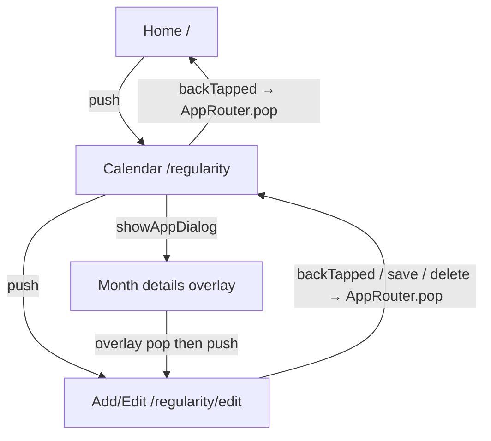

# Regularity Calendar review fixes — Design & Layout Specification

<!--
  AGENT METADATA — parse before implementing
  feature_id: regularity-calendar-review-fix
  product_name: Budget Manager
  source: Cursor Automation reviews on PR (navigation, dialog, repo errors, edit load safety, finite amount)
  target_platform: Flutter (Android-focused mobile)
  status: shipped
-->

> **Purpose:** Close the convention review on Regularity Calendar without
> changing product behaviour. Three fixes: BLoC-owned back navigation, month
> popup via `showAppDialog`, and repository error handling. The product owner
> explicitly declined the generated Home Freezed fix because Freezed outputs
> are intentionally ignored.
> **Audience:** Coding agents and contributors. Follow `AGENTS.md` and
> `docs/architecture.md` before writing code.
> **Parent feature:** [`regularity-calendar-design-spec.md`](regularity-calendar-design-spec.md).
> **UI tokens / components:** [`ui-theme-design-spec.md`](ui-theme-design-spec.md),
> [`DESIGN_SYSTEM.md`](DESIGN_SYSTEM.md),
> [`UI_IMPLEMENTATION_GUIDE.md`](UI_IMPLEMENTATION_GUIDE.md).
> **Routes / home hub:** [`screens-navigation-design-spec.md`](screens-navigation-design-spec.md).

---

## Document map

| § | Section |
|---|---------|
| 0 | [Repo conventions](#0-repo-conventions) |
| 1 | [Feature overview](#1-feature-overview) |
| 2 | [Data model](#2-data-model) |
| 3 | [Component reuse](#3-component-reuse) |
| 4 | [Screens](#4-screens) |
| 5 | [Navigation & state](#5-navigation--state) |
| 6 | [Interaction & tokens](#6-interaction--tokens) |
| 7 | [Out of scope](#7-out-of-scope) |
| A | [Implementation checklist](#appendix-a-implementation-checklist) |
| B | [Review mapping](#appendix-b-review-mapping) |

---

## 0. Repo conventions

| Rule | This change |
|------|-------------|
| BLoC + Freezed | Run codegen locally for changed Regularity event/state sources; do **not** add ignored Home output |
| Routes in `lib/router/app_router.dart` | **No new routes** |
| Navigation in BLoCs | Calendar and edit **route** back via `AppRouter.pop()`. Overlay dismiss (`Navigator.pop` on the month dialog) stays allowed |
| Widget classes | Shared: extend `ScreenHeader` and `showAppDialog`. Month dialog stays **private in** `regularity_calendar_view.dart` |
| Infra I/O | Still `RegularPaymentRepository` only |
| Persistence | **No** schema / version bump |
| Writes | Repository methods; **no** `domain/use_cases/` |
| Errors | Calendar/write failures use `SnackBar`; invalid/missing/failed edit loads pop |
| Theme | `context.appColors` + text theme only |

**Replaces:** Conflicting bits in
[`regularity-calendar-design-spec.md`](regularity-calendar-design-spec.md)
(raw `showDialog`/`AlertDialog`; ScreenHeader implicit pop; missing repository
error recovery).

**Reference implementations:** `showAppDialog` callers (delete confirm),
`CustomListTile` in the month dialog, existing `SnackBar` on
`RegularityEditView`.

---

## 1. Feature overview

### 1.1 Product rules

Unchanged from the parent spec: calendar months 1–12, year display-only, month
details as a faded **alert-style** overlay, add/edit with validation, save/delete
**pop** so Calendar can pop to Home. No budget integration.

This follow-up only makes that implementation comply with architecture and UI
docs.

### 1.2 Navigation pattern



### 1.3 Screens

No new screens. Touch:

| Surface | Path | Change |
|---------|------|--------|
| ScreenHeader | `screens/components/layout/title_bar.dart` | Optional `onBack` |
| App dialog | `screens/components/app_dialog.dart` | Rich content + `barrierColor` |
| Calendar | `screens/regularity/calendar/` | `onBack`, `showAppDialog`, load errors |
| Edit | `screens/regularity/edit/` | `onBack`, start/save/delete errors |

### 1.4 Flows

1. **Calendar back:** view `backTapped` → BLoC `AppRouter.pop()` → Home.
2. **Edit back:** same → Calendar (still on stack).
3. **Month details:** `showAppDialog` with widget body + faded scrim; barrier
   dismiss uses overlay `Navigator.pop`.
4. **Repo failure:** flags cleared; `errorMessage` → `SnackBar`; UI not stuck.

---

## 2. Data model

**No entity, table, or migration change.**

Calendar state gains `errorMessage` (`String?`, default `null`) so load
failures can surface. Edit already has `errorMessage`.

Regular payment validation accepts only finite amounts strictly greater than
zero; `Infinity`, `NaN`, zero, and negative values are invalid.

---

## 3. Component reuse

| Widget / API | Change |
|--------------|--------|
| `ScreenHeader` | `onBack` routes through BLoC; `backEnabled: false` visibly disables without `Navigator.pop` fallback |
| `showAppDialog` | Keep `String content` for existing callers. Add optional `Widget? contentWidget` and `Color? barrierColor`. Allow `cancelLabel: null` and omitted confirm (no action row) |
| `_RegularityMonthDialog` | Stay private in `regularity_calendar_view.dart`. Passed as `contentWidget` |
| `SnackBar` | Calendar + edit listen for `errorMessage` |

Do **not** add a new shared month-dialog file.

---

## 4. Screens

### Regularity Calendar

- `ScreenHeader(..., onBack: () => add(backTapped()))`.
- Month popup: `showAppDialog` with month name as `title`, `contentWidget` =
  list + total, `barrierColor: colors.onScaffold.withValues(alpha: 0.5)`,
  `cancelLabel: null`.
- Tile tap still pops the overlay then `openEdit(id)`.
- `_load`: `try`/`catch`; always `isLoading: false`; on error set
  `errorMessage` (e.g. `Could not load regular payments.`).
- `openCreate` / `openEdit` share an in-progress flag until `router.push`
  returns, then reload. A second tap cannot stack another edit route.
- `BlocListener` / existing consumer shows `SnackBar`.

### Add / Edit

- Same `onBack` → `backTapped` → `AppRouter.pop()`.
- Create uses `id == null`; malformed/non-positive ids, missing records, and
  load exceptions pop. They never become create mode.
- Header and system back stay disabled during `isLoading` and `isSaving`;
  `backTapped` is ignored in both states to prevent double-pop races.
- Save and delete share an in-flight write guard: extra `saveTapped` /
  `deleteConfirmed` events are dropped while loading or a write is pending.
- Delete stays `showAppDialog` with string `content`.
- Wrap `getById` / `create` / `update` / `delete` in `try`/`catch`.
- On failure: `isLoading: false`, `isSaving: false`, `errorMessage` (e.g.
  `Could not save payment.` / `Could not delete payment.`).
- Do **not** `pop` after a failed save/delete.

---

## 5. Navigation & state

### Events to add

**Calendar:** `RegularityCalendarEvent.backTapped()`.

**Edit:** `RegularityEditEvent.backTapped()`.

Handlers: `router.pop()` only. Do not `go('/regularity')` or `goHome()`.

### Overlay vs route

| Action | Mechanism |
|--------|-----------|
| Calendar / edit back | BLoC + `AppRouter.pop()` |
| Edit back while loading/saving | Disabled / ignored |
| Invalid, missing, or failed edit load | BLoC `AppRouter.pop()` |
| Month dialog dismiss / barrier | `Navigator.pop` on overlay |
| Month tile → edit | Overlay pop, then BLoC `push` |
| Extra create/edit while a push is open | Ignored until `push` returns |
| Extra save/delete while loading or writing | Dropped |

### Stack

Unchanged: `Home` → push → `Calendar` → push → `Edit`.

---

## 6. Interaction & tokens

- Month popup must still look like an **alert** over a faded calendar (not a
  sheet, not a route).
- Scrim: `onScaffold` ~0.45–0.55 alpha. Dialog surface from existing
  `dialogTheme` / `surface`.
- No new `AppThemeColors` fields. No emojis. 1px borders.
- `showAppDialog` confirm buttons stay `primaryAction` / `error` as today;
  month popup has **no** confirm/cancel row.

---

## 7. Out of scope

- Wiring `onBack` on every existing `ScreenHeader` (follow-up)
- Removing `*.freezed.dart` from `.gitignore` globally
- Tracking or fixing ignored Home Freezed output (explicit product-owner
  decision for this follow-up)
- Use-case layer
- Budget integration
- Schema changes / version bump
- Changing month details into a route or bottom sheet
- `analysis_options.yaml` (unrelated local dirty file)

---

## Appendix A. Implementation checklist

```
[x] Home Freezed finding intentionally excluded per product owner
[x] ScreenHeader.onBack; calendar + edit dispatch backTapped; BLoCs AppRouter.pop
[x] showAppDialog: contentWidget + barrierColor; existing string callers still compile
[x] Calendar month popup uses showAppDialog; widget stays in regularity_calendar_view.dart
[x] Calendar + edit catch repo errors; clear loading/saving; SnackBar
[x] Update regularity-calendar-design-spec.md dialog + back + checklist to match
[x] UI_IMPLEMENTATION_GUIDE.md: rich dialogs go through showAppDialog
[x] dart run build_runner build --delete-conflicting-outputs
[x] flutter analyze (11 pre-existing infos; no new fix-scope findings)
[x] flutter test (16 passing)
[x] Manual Android regression: rich dialog, edit back, calendar back
[x] Reject non-finite and non-positive amounts
[x] Malformed/missing/failed edit loads pop instead of becoming create
[x] Disable header/system back while edit loads or saves
[x] Re-run flutter test / analyze and edit-load navigation regression
[x] Drop overlapping edit save/delete; pending-repo duplicate and mixed tests
[x] Gate calendar create/edit until active push returns; regression test
[x] ScreenHeader trailing uses a null-aware collection element
[x] Ignore Home Freezed/codegen (product owner)
```

Order: (1) `ScreenHeader` + back events, (2) `showAppDialog` + calendar popup,
(3) repo errors, (4) docs, (5) verify.

Prefer one `[fix]` commit.

---

## Appendix B. Review mapping

| Review blocker | This spec |
|----------------|-----------|
| Missing `_OpenRegularity` in ignored Home output | Explicitly excluded by product owner |
| `ScreenHeader` `Navigator.pop` on routed screens | §4, §5 |
| Raw `showDialog`/`AlertDialog` vs `showAppDialog()` | §3, §4 Calendar, §6 |
| Uncaught repository I/O | §4, §2 `errorMessage` |
| Private dialog in `*_view.dart` | §3 (already true; keep it) |
| Delete required | Already implemented; do not regress |
| Failed edit load becomes create | Pop for invalid/missing/exception |
| Back/save race double-pops | Disable and ignore back while loading/saving |
| Concurrent save/delete writes | Shared in-flight guard; drop extra events |
| Double create/edit push | Shared in-progress flag until `push` returns |
| `if (trailing != null) trailing!` | Null-aware `?trailing` in `ScreenHeader` |
| Non-finite amount accepted | Require `amount.isFinite` and `amount > 0` |
| Remaining `showDialog` / sibling wording | Parent and navigation specs corrected |
