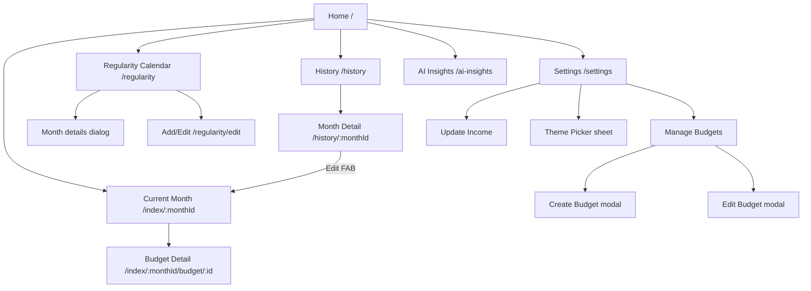

# Screens & navigation — Design & Layout Specification

<!--
  AGENT METADATA — parse before implementing
  feature_id: screens-navigation
  product_name: Budget Manager
  source: codebase lib/router + lib/screens; archive docs/FIGMA_AI_DESIGN_BRIEF.md
  target_platform: Flutter (Android-focused mobile)
  status: shipped
-->

> **Purpose:** Routes, screen map, and main user flows.
> **Audience:** Coding agents and contributors. Follow `AGENTS.md` and
> `docs/architecture.md` before writing code.
> **UI tokens / components:** [`ui-theme-design-spec.md`](ui-theme-design-spec.md),
> [`DESIGN_SYSTEM.md`](DESIGN_SYSTEM.md), [`UI_IMPLEMENTATION_GUIDE.md`](UI_IMPLEMENTATION_GUIDE.md).
> **Domain rules:** [`budgeting-core-design-spec.md`](budgeting-core-design-spec.md).
> **Regularity Calendar:** [`regularity-calendar-design-spec.md`](regularity-calendar-design-spec.md).
> **Regularity × budgets:** [`regularity-budget-integration-design-spec.md`](regularity-budget-integration-design-spec.md).
> **Review fixes:** [`regularity-calendar-review-fix-design-spec.md`](regularity-calendar-review-fix-design-spec.md).

---

## Document map

| § | Section |
|---|---------|
| 0 | [Repo conventions](#0-repo-conventions) |
| 1 | [Feature overview](#1-feature-overview) |
| 2 | [Data model](#2-data-model) |
| 3 | [Component reuse](#3-component-reuse) |
| 4 | [Screens](#4-screens) |
| 5 | [Navigation & state](#5-navigation--state) |
| 6 | [Interaction & tokens](#6-interaction--tokens) |
| 7 | [Out of scope](#7-out-of-scope) |
| A | [Implementation checklist](#appendix-a-implementation-checklist) |

---

## 0. Repo conventions

| Rule | This feature |
|------|--------------|
| BLoC + Freezed | Each screen folder: `*_bloc`, `*_event`, `*_state`, `*_view` |
| Routes in `lib/router/app_router.dart` | Register every new screen; BLoC uses `AppRouter` only |
| Navigation in BLoCs | Views dispatch events — no `context.push` / `context.go` |
| Widget classes | Shared: `screens/components/`; screen-private: in `*_view.*` |
| Infra I/O | Repositories via DI into BLoCs |
| Persistence | See budgeting-core spec |
| Theme | `context.appColors` + text theme |

**Replaces:** Competing screen inventories — this file + budgeting-core + UI docs
are authoritative. The Figma brief is an archive stub.

**Reference implementations:** `home/`, `live/index/`, `settings/`.

---

## 1. Feature overview

### 1.1 Navigation pattern

Hub-and-spoke from **Home**. No bottom nav, drawer, or tabs. Sub-screens use
`ScreenHeader` / title bar with back (BLoC `pop` or overlay dismiss).



### 1.2 Screens

| Screen | Route | Folder | Top bar |
|--------|-------|--------|---------|
| Home | `/` | `screens/home/` | None (branding hub) |
| Current Month | `/index/:monthId` | `screens/live/index/` | Month name |
| Budget Detail | `/index/:monthId/budget/:budgetByMonthId` | `screens/live/show/` | Budget name |
| History Index | `/history` | `screens/history/history_index/` | History |
| History Detail | `/history/:monthId` | `screens/history/history_show/` | Month name |
| Settings | `/settings` | `screens/settings/` | Settings |
| Manage Budgets | `/settings/manage-budgets` | `screens/settings/manage_budgets/` | Manage Budgets |
| Update Income | `/settings/update-income` | `screens/settings/update_income/` | Update Income |
| AI Insights | `/ai-insights` | `screens/ai_insights/` | AI Insights |
| Regularity Calendar | `/regularity` | `screens/regularity/calendar/` | Regularity Calendar |
| Regularity add/edit | `/regularity/edit`, `/regularity/edit/:id` | `screens/regularity/edit/` | New payment / Edit payment |

Month details is an **AlertDialog** on the calendar (faded scrim), not a
route. Full layout and domain rules:
[`regularity-calendar-design-spec.md`](regularity-calendar-design-spec.md).

Entry: app launches on Home (`/`).

### 1.3 Flows

- **Home → Live / History / Regularity Calendar / Settings / AI:** BLoC
  navigation events.
- **Regularity Calendar → add/edit:** BLoC **`push`** registered edit route.
  Further create/edit pushes wait until the active `push` returns. Month
  details is a **dialog** (`showAppDialog`), not a route. Save/delete **`pop`**
  so Home remains under Calendar. Overlapping save/delete is dropped.
- **Live → Budget Detail:** BLoC should push registered route (prefer event +
  `AppRouter`; do not add new view-level `context.push`).
- **History Detail → Live:** Edit FAB → push `/index/:monthId`.
- **Settings → Manage Budgets / Update Income:** BLoC pushes.
- **Theme:** bottom sheet from Settings (local overlay).
- **Back:** BLoC `router.pop()` or header back wired through BLoC/events.

---

## 2. Data model

Budget screens consume `Month`, `Budget`, `BudgetByMonth` — see
[`budgeting-core-design-spec.md`](budgeting-core-design-spec.md).

Regularity Calendar consumes `RegularPayment` — see
[`regularity-calendar-design-spec.md`](regularity-calendar-design-spec.md).

Live Index and History Show list matching regulars (live vs
`RegularPaymentSnapshot`) without new routes. Spec:
[`regularity-budget-integration-design-spec.md`](regularity-budget-integration-design-spec.md).

---

## 3. Component reuse

| Widget | Use when |
|--------|----------|
| `ScreenHeader` (`layout/title_bar.dart`) | Sub-screens with title + back |
| `NavCard` | Home / Settings rows; `isAi: true` for AI entry |
| `SummaryStatCard` | Key metrics |
| `ProgressPill` (`box_used_of_max.dart`) | Spend vs limit / income |
| `BudgetByMonthListTile` | Budget rows in live/history |
| `MonthListTile` | History index rows |
| `CustomListTile` / `CustomListView` | Settings-style lists |
| `SectionLabel` | Uppercase section headings |
| `AddAdjustButton` / `SubtractAdjustButton` | Spend adjust |
| `CustomSwitch` | Visibility toggles in modals |
| `AppDialog` / `showAppDialog()` | Confirmations / alerts |

Full guidance: [`UI_IMPLEMENTATION_GUIDE.md`](UI_IMPLEMENTATION_GUIDE.md).

---

## 4. Screens

### Home

```yaml
route: /
folder: lib/screens/home/
bloc: HomeBloc
view: HomeView
```

- Branding block (`BUDGET MANAGER` + title); no `ScreenHeader`.
- Nav cards: Current Month (with income progress), History, Regularity
  Calendar, Settings, AI Insights.
- Long-press branding may refresh (existing affordance).

### Current Month (Live Index)

```yaml
route: /index/:monthId
folder: lib/screens/live/index/
bloc: IndexBloc
view: IndexView
```

- Summary: income spent, budgeted income %.
- Optional stale-month warning banner.
- Budget list → detail route.
- FABs: refresh; conditional close-month (destructive styling). Close goes
  through `CloseMonthUseCase` (snapshot + `closedOn`).
- 1px divider + display-only regular payments for the calendar
  month; totals include those amounts. Not tappable. Close freezes a
  snapshot — [`regularity-budget-integration-design-spec.md`](regularity-budget-integration-design-spec.md).

### Budget Detail (Live Show)

```yaml
route: /index/:monthId/budget/:budgetByMonthId
folder: lib/screens/live/show/
bloc: ShowBloc
view: ShowView
```

- Hero `currentUsed`; subtitle limit; quick adjust (+1, ±5, ±20, ±50); custom amount.
- Long-press limit → Fill to Max dialog.
- Spending cannot go below 0; saves immediately.

### History Index / Show

- Index: months newest-first with progress pill.
- Show: read-only budget list; Edit FAB → Live Index for that month.
- Show lists snapshot regular-payment names under a divider;
  income spent and index pills include snapshot `amount`.

### Settings

- Manage Budgets, Update Income, Color Theme (opens theme picker sheet).

### Manage Budgets

- List with visibility icon + limit; FAB → create modal; tap → edit modal.
- Empty: “No budgets yet. Tap + to add one.”

### Update Income

- Context label “{Month} and onwards”; income field; Save.

### AI Insights

- Start/End month dropdowns; Analyse (`aiAccent`).
- States: loading + elapsed timer; success card; unsupported (Play Store link);
  error dialog.
- Uses `flutter_local_ai`; results not persisted.

### Regularity Calendar

- 3×4 calendar-month grid with per-month payment sums; rectangular + bar
  (grid width) → add screen. Optional year label is display-only.
- Month cell → **alert-style dialog** (calendar faded behind); tiles + total.
- Shared add/edit screen: name, numeric amount, 3×4 month select, hanging
  save FAB; save/delete **pops**.
- Spec: [`regularity-calendar-design-spec.md`](regularity-calendar-design-spec.md).

---

## 5. Navigation & state

### Routes (go_router)

Registered in `lib/router/app_router.dart` — paths listed in §1.2.
`AppRouter` helpers: `go`, `push`, `pop`, `goHome`.

### BLoC events (typical)

- `started` / refresh / open-* / back / closeMonth / adjust / save — follow
  existing Freezed event names per screen.
- Navigation-intent events handled only in the BLoC.

### DI

BLoCs registered as factories in `lib/di/di.dart` `registerScreens()`.

---

## 6. Interaction & tokens

- Screen padding, radii, FAB rules: [`UI_IMPLEMENTATION_GUIDE.md`](UI_IMPLEMENTATION_GUIDE.md).
- No emojis; no 3px borders; all 6 themes functional.
- Modals: `showModalBottomSheet` + drag handle; dialogs via `showAppDialog()`.

---

## 7. Out of scope

- Bottom navigation / tabs / drawer
- Deep links beyond registered go_router paths (unless explicitly requested)
- Saving AI insight history

---

## Appendix A. Implementation checklist

```
[ ] Screen folder with Freezed BLoC + view
[ ] Route in AppRouter + DI factory
[ ] Navigation only from BLoC via AppRouter
[ ] Reuse components; tokens via context.appColors / textTheme
[ ] Update this spec + budgeting-core if routes/flows change
[ ] flutter analyze
```
